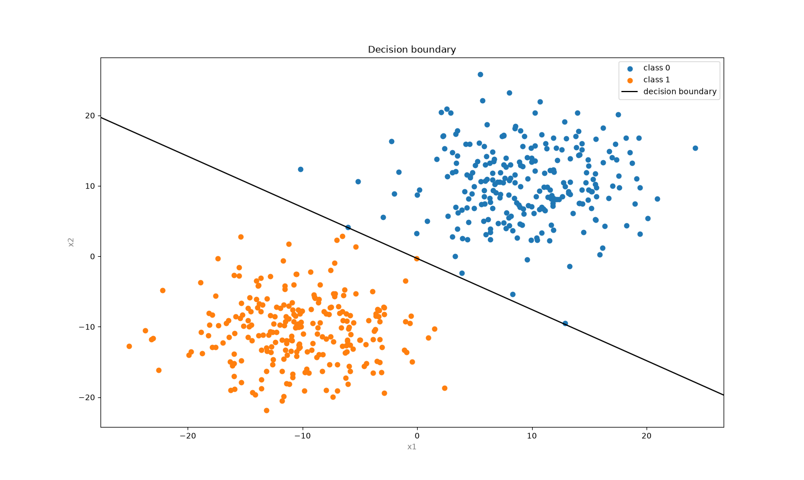
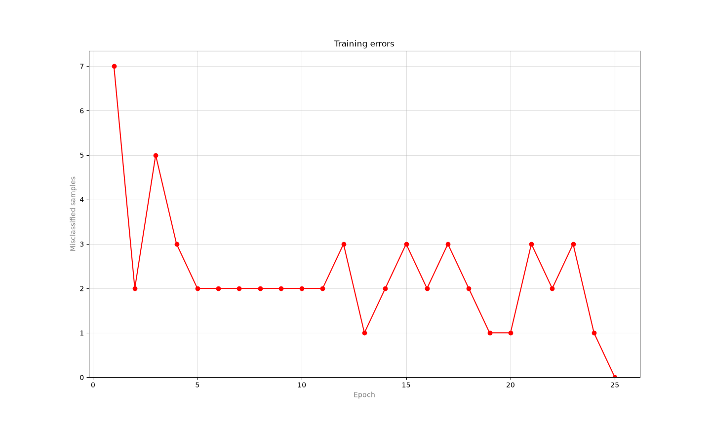
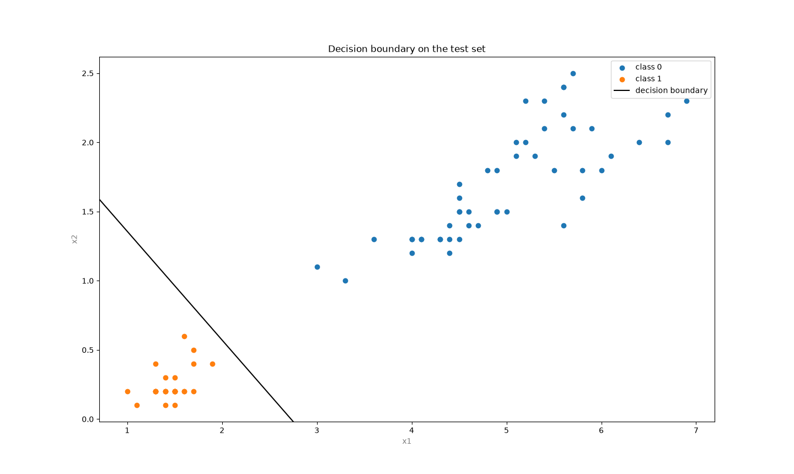

# Perceptron from scratch

[](https://github.com/yosshhii/perceptron-from-scratch/actions/workflows/ci.yml)


A single-layer perceptron for binary classification, implemented by hand with NumPy.
It trains on synthetic 2D clusters or on the Iris dataset, reports accuracy on
held-out samples, and plots the decision boundary and the training error curve.

<p align="center">
  
  
</p>

## Features

- **Perceptron without ML libraries.** Step activation, the perceptron learning rule
  `w += lr · (target − pred) · x`, and early stopping once an epoch has no errors.
- **Synthetic data.** Two Gaussian clusters around different centers,
  reproducible via `--seed`.
- **Real data.** Iris: setosa vs. the other species, using petal length and width.
- **Train/test split.** The CLI trains on 80% of the samples by default and
  evaluates accuracy on the remaining 20%.
- **Visualization.** Decision boundary over class-colored test samples and
  training errors per epoch.
  Plots can be shown interactively or saved as PNG files.
- **Simple CLI.** One command to run, clear error messages instead of tracebacks.
- **Code quality.** Type hints, `ruff`, `mypy --strict`, `pytest` tests, and CI on GitHub Actions.

## How it works

The perceptron computes a weighted sum of the input features and compares it with zero:

```
z = w · x + b
prediction = 1 if z ≥ 0 else 0
```

Here `x` is a feature vector of any length `n`, and `w` holds one weight per feature.
The decision boundary is the set of points where `z = 0`, i.e. the hyperplane
`w · x + b = 0`. With two features it is the line `w₁x₁ + w₂x₂ + b = 0`,
which is what the boundary plot shows.

When a sample is misclassified, the weights move toward the correct answer:

```
w ← w + lr · (target − prediction) · x
b ← b + lr · (target − prediction)
```

If the classes are linearly separable, the perceptron is guaranteed to find a separating
hyperplane in a finite number of updates (Novikoff's theorem). On non-separable data,
training stops when the epoch limit is reached.

## Installation

Requires [uv](https://docs.astral.sh/uv/), which installs the right Python version
and all dependencies.

```bash
git clone https://github.com/yosshhii/perceptron-from-scratch
cd perceptron-from-scratch
uv sync
```

## Usage

```bash
uv run perceptron --samples 200 --lr 0.1 --epochs 50
```

With the default split and seed (`0`), this command uses 160 samples for training
and 40 for testing. It produces the following report:

```
Test set: clusters (40 samples, 2 features)
Training: 2 epochs, converged
Test accuracy: 1.000
```

### Harder synthetic clusters

Generate 1,000 samples with closer cluster centers and a larger spread than in
the default example. With seed `0` and the default 80/20 split, training
converges after 22 epochs and correctly classifies 199 of 200 test samples.

```bash
uv run perceptron --samples 1000 --offset 2.31 --spread 1.2
```

```
Test set: clusters (200 samples, 2 features)
Training: 22 epochs, converged
Test accuracy: 0.995
```

More examples:

```bash
uv run perceptron --plot                     # show plots
uv run perceptron --dataset iris --plot      # train on Iris
uv run perceptron --save-dir docs/           # save plots as PNG files
uv run perceptron --test-size 0.25           # hold out 25% for testing
uv run perceptron --help                     # list all options
```

You can also run the package as a module: `uv run python -m perceptron ...`

### Options

| Option | Default | Description |
|---|---|---|
| `--samples` | `200` | number of points (`clusters` only) |
| `--offset` | `5.0` | cluster center offset (`clusters` only) |
| `--spread` | `1.0` | cluster standard deviation (`clusters` only) |
| `--lr` | `0.1` | learning rate, must be positive |
| `--epochs` | `50` | maximum number of epochs, at least 1 |
| `--test-size` | `0.2` | fraction held out for testing, strictly between 0 and 1 |
| `--seed` | `0` | random seed for cluster generation and train/test splitting |
| `--dataset` | `clusters` | `clusters` or `iris` |
| `--plot` | off | show plots after training |
| `--save-dir` | None | directory to save plots as PNG |

The test sample count is rounded up to a whole number. The split must leave at
least one sample for training.

## Iris

A perceptron distinguishes only two classes, so the task is reduced to
"setosa vs. the rest". Two features are used - petal length and petal width:
setosa is linearly separable on them, and the boundary can be drawn on a plane.
With a test fraction of `0.5`, 75 samples are used for training and 75 are held
out for testing. The split is random, so class proportions can vary with `--seed`.

Run `uv run perceptron --dataset iris --test-size 0.5` to reproduce this report
with the default seed (`0`):

```
Test set: iris (75 samples, 2 features)
Training: 2 epochs, converged
Test accuracy: 1.000
```

<p align="center">
  
</p>

## Project structure

```
.
├── src/perceptron/
│   ├── model.py      # Perceptron class
│   ├── data.py       # cluster generation, Iris loading, and train/test splitting
│   ├── plots.py      # decision boundary and error curve
│   ├── cli.py        # argument parsing and entry point
│   └── __main__.py   # enables `python -m perceptron`
├── tests/
│   ├── test_model.py
│   ├── test_data.py
│   └── test_integration.py
├── .github/workflows/ci.yml
└── pyproject.toml
```

## Development

```bash
uv run pytest                  # run tests
uv run ruff format .           # format code
uv run ruff check .            # lint
uv run mypy src tests          # type check
```

The same checks run on GitHub Actions on every push.

# Author

**Egor Fedosimov** - [@yosshhii](https://github.com/yosshhii)\
HSE University · Computer Science and Technology · 2nd year
