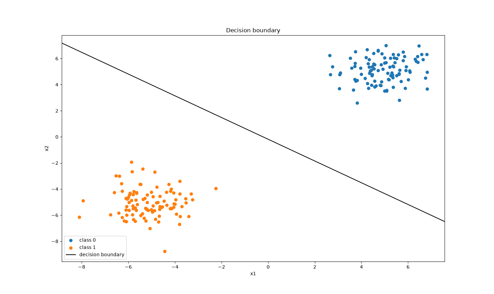
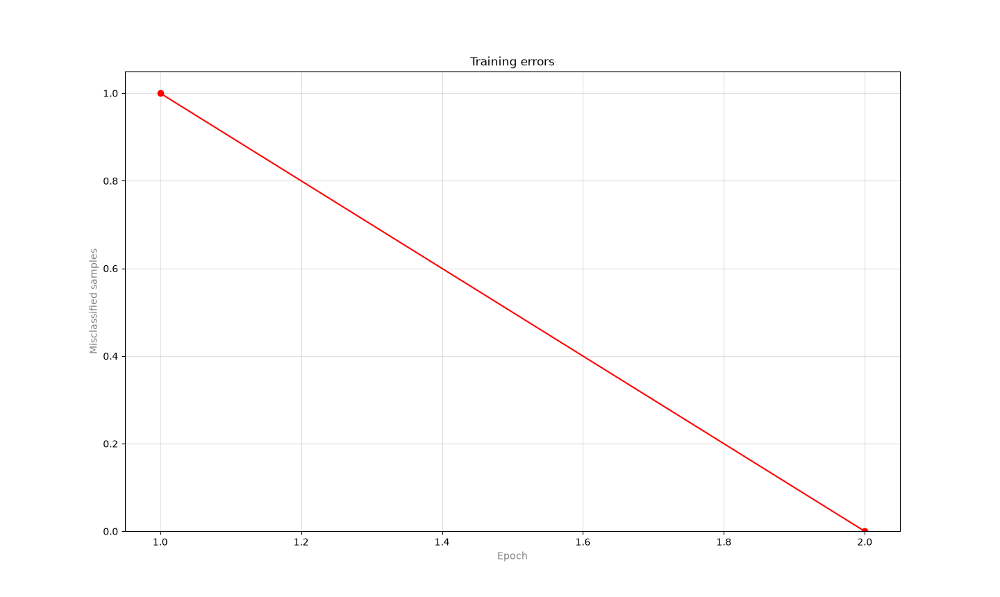
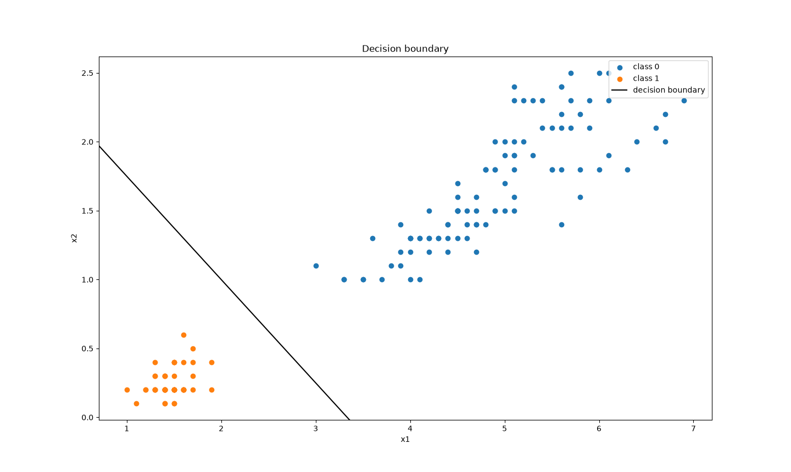

# Perceptron from scratch

[](https://github.com/yosshhii/perceptron-from-scratch/actions/workflows/ci.yml)


A single-layer perceptron for binary classification, implemented by hand with NumPy.
It trains on synthetic 2D clusters or on the Iris dataset, prints its accuracy,
and plots the decision boundary and the training error curve.

<p align="center">
  
  
</p>

## Features

- **Perceptron without ML libraries.** Step activation, the perceptron learning rule
  `w += lr · (target − pred) · x`, and early stopping once an epoch has no errors.
- **Synthetic data.** Two Gaussian clusters around different centers,
  reproducible via `--seed`.
- **Real data.** Iris: setosa vs. the other species, using petal length and width.
- **Visualization.** Decision boundary over class-colored samples and errors per epoch.
- **Simple CLI.** One command to run, clear error messages instead of tracebacks.
- **Code quality.** Type hints, `ruff`, `mypy --strict`, `pytest` tests, and CI on GitHub Actions.

## How it works

The perceptron computes a weighted sum of the input features and compares it with zero:

```
z = w · x + b
prediction = 1 if z ≥ 0 else 0
```

Here `x` is a feature vector of any length `n`, and `w` holds one weight per feature.
The decision boundary is the set of points where `z = 0`, i.e. the hyperplane
`w · x + b = 0`. With two features it is the line `w₁x₁ + w₂x₂ + b = 0`,
which is what the boundary plot shows.

When a sample is misclassified, the weights move toward the correct answer:

```
w ← w + lr · (target − prediction) · x
b ← b + lr · (target − prediction)
```

If the classes are linearly separable, the perceptron is guaranteed to find a separating
hyperplane in a finite number of updates (Novikoff's theorem). On non-separable data,
training stops when the epoch limit is reached.

## Installation

Requires [uv](https://docs.astral.sh/uv/), which installs the right Python version
and all dependencies.

```bash
git clone https://github.com/yosshhii/perceptron-from-scratch
cd perceptron-from-scratch
uv sync
```

## Usage

```bash
uv run perceptron --samples 200 --lr 0.1 --epochs 50
```

Example output:

```
Dataset: clusters (200 samples, 2 features)
Training: 2 epochs, converged
Accuracy: 1.000
```

More examples:

```bash
uv run perceptron --plot                   # show plots
uv run perceptron --dataset iris --plot    # train on Iris
uv run perceptron --help                   # list all options
```

You can also run the package as a module: `uv run python -m perceptron ...`

### Options

| Option | Default | Description |
|---|---|---|
| `--samples` | `200` | number of points (`clusters` only) |
| `--lr` | `0.1` | learning rate, must be positive |
| `--epochs` | `50` | maximum number of epochs, at least 1 |
| `--seed` | `0` | random seed for data generation |
| `--dataset` | `clusters` | `clusters` or `iris` |
| `--plot` | off | show plots after training |

## Iris

A perceptron distinguishes only two classes, so the task is reduced to
"setosa vs. the rest". Two features are used - petal length and petal width:
setosa is linearly separable on them, and the boundary can be drawn on a plane.
Training converges in 3 epochs with an accuracy of 1.0.

<p align="center">
  
</p>

## Project structure

```
.
├── src/perceptron/
│   ├── model.py      # Perceptron class
│   ├── data.py       # cluster generation and Iris loading
│   ├── plots.py      # decision boundary and error curve
│   ├── cli.py        # argument parsing and entry point
│   └── __main__.py   # enables `python -m perceptron`
├── tests/
│   ├── test_model.py
│   ├── test_data.py
│   └── test_integration.py
├── .github/workflows/ci.yml
└── pyproject.toml
```

## Development

```bash
uv run pytest                  # run tests
uv run ruff format .           # format code
uv run ruff check .            # lint
uv run mypy src tests          # type check
```

The same checks run on GitHub Actions on every push.

# Author

**Egor Fedosimov** - [@yosshhii](https://github.com/yosshhii)\
HSE University · Computer Science and Technology · 2nd year